# AUSENTRACK
### Sistema de Gestión de Talento Humano


AUSENTRACK es una plataforma web de gestión integral de Talento Humano para
empresas colombianas (desarrollada para las sedes de Poke). Empezó como un
sistema de seguimiento de incapacidades laborales y creció hasta cubrir todo
el ciclo de vida del colaborador: desde que se abre la vacante hasta que la
persona se retira.

Proyecto de grado — Ingeniería de Software, Universidad Politécnico
Grancolombiano.

---

## Módulos del sistema

| Módulo | Qué hace |
|---|---|
| **Dashboard** | Resumen general con indicadores y gráficas de los módulos principales |
| **Colaboradores** | Ficha completa (salario, bonos, afiliaciones, punto de venta), importación masiva por Excel, retiro y reactivación |
| **Seguridad Social** | Catálogo de EPS, ARL, Cajas de Compensación y Fondos de Pensión |
| **SST · Incapacidades** | Registro, prórrogas (límite 540 días), documentos adjuntos, cálculo automático del responsable de pago |
| **SST · Dotación y EPP** | Inventario por talla, entregas con constancia de firma, matriz de riesgos por cargo |
| **Procesos Disciplinarios** | Llamados de atención y cartas, alertas de reincidencia y de casos estancados |
| **Reclutamiento** | Vacantes + pipeline de candidatos tipo kanban; al contratar, genera el colaborador automáticamente |
| **Contratos** | Generación de PDF, control de vencimientos, renovación encadenada |
| **Evaluaciones de Desempeño** | Calificación por criterios (1-5), ranking, y **link público** para que el colaborador se autoevalúe sin registrarse |
| **Capacitaciones** | Cursos con control de asistencia y alerta de inducción pendiente |
| **Puntos de Venta** | Personal requerido vs. real por sede, detección de nombres mal escritos |
| **Vacaciones** | Saldo automático (15 días hábiles/año), aprobación/rechazo, e integración opcional con JotForm |
| **Retiros** | Checklist de entrega, liquidación, entrevista de salida y tasa de rotación |
| **Reportes** | Exportación a Excel y PDF con filtros |
| **Usuarios / Auditoría** | Roles (Admin, Talento Humano, Nómina) y trazabilidad de acciones |

Los módulos de personal están conectados entre sí por **relaciones reales de
base de datos**, no solo por coincidencia de texto: así, "Poke 2" y "Poke2"
siempre se cuentan como el mismo punto de venta, y al contratar a un candidato
su ficha de colaborador se genera sola heredando cargo y sede.

---

## Capturas

Tomadas con los datos de demostración (`python manage.py cargar_demo`): la empresa, las personas y los movimientos son ficticios.

| | |
|---|---|
| **Dashboard** 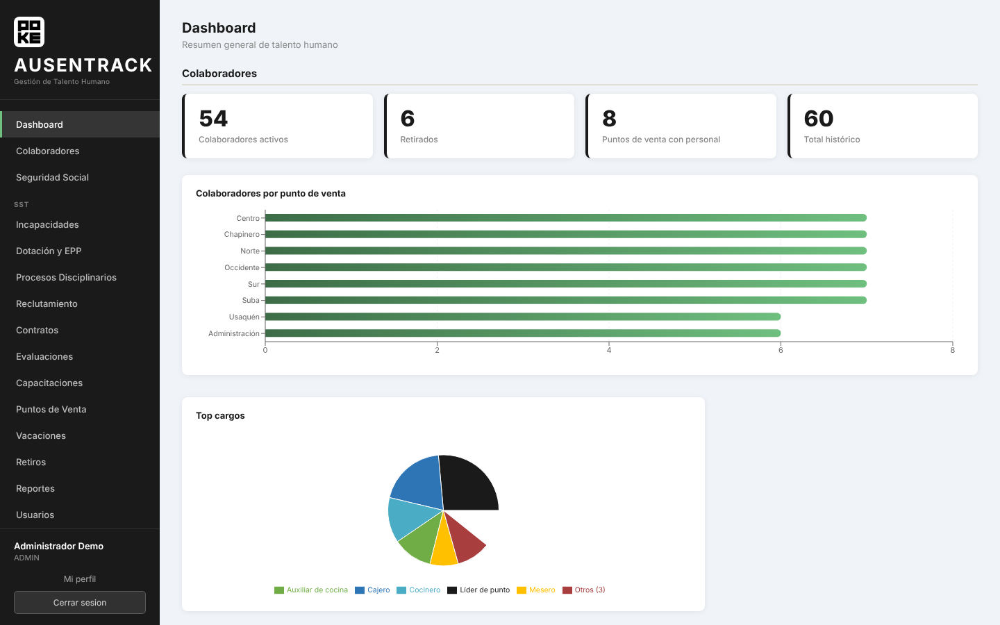 | **Incapacidades** 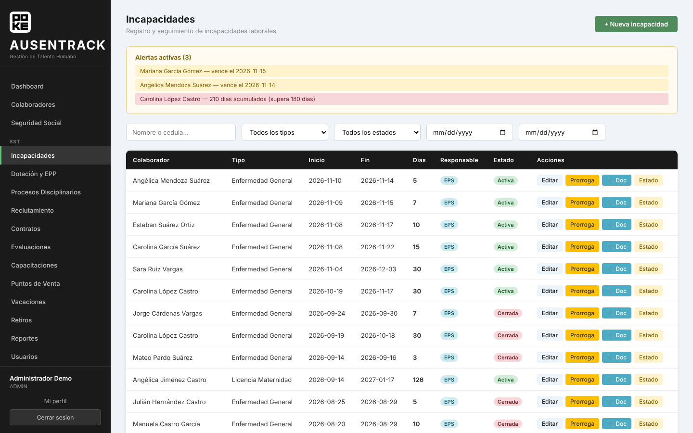 |
| **Colaboradores** 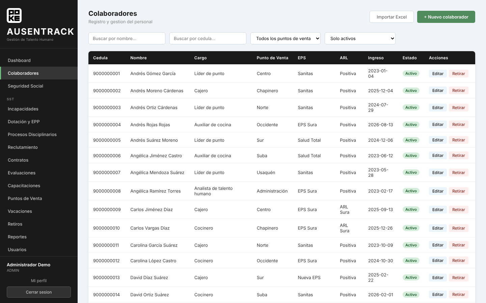 | **Vacaciones** 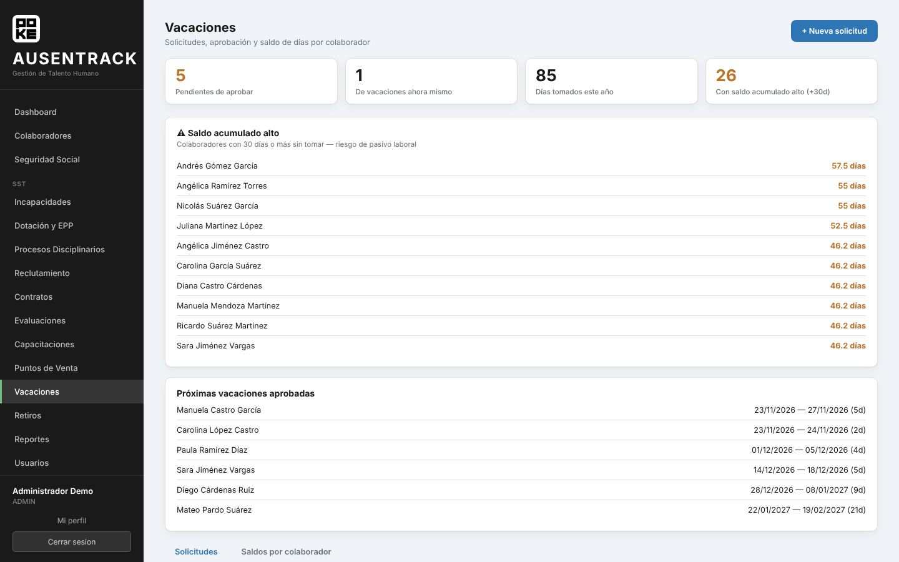 |
| **Contratos** 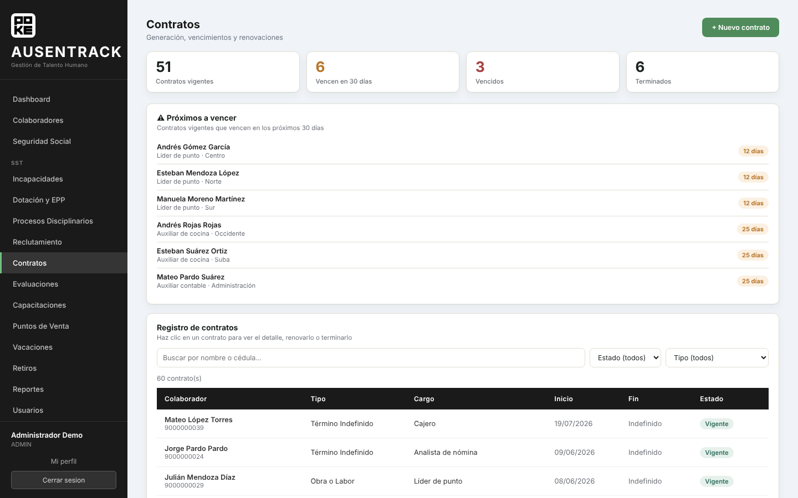 | **Reclutamiento** 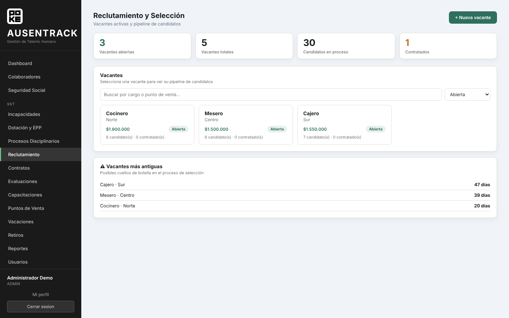 |
| **Evaluaciones** 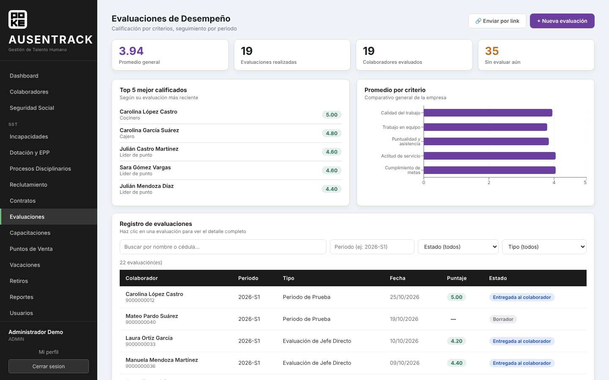 | **Capacitaciones** 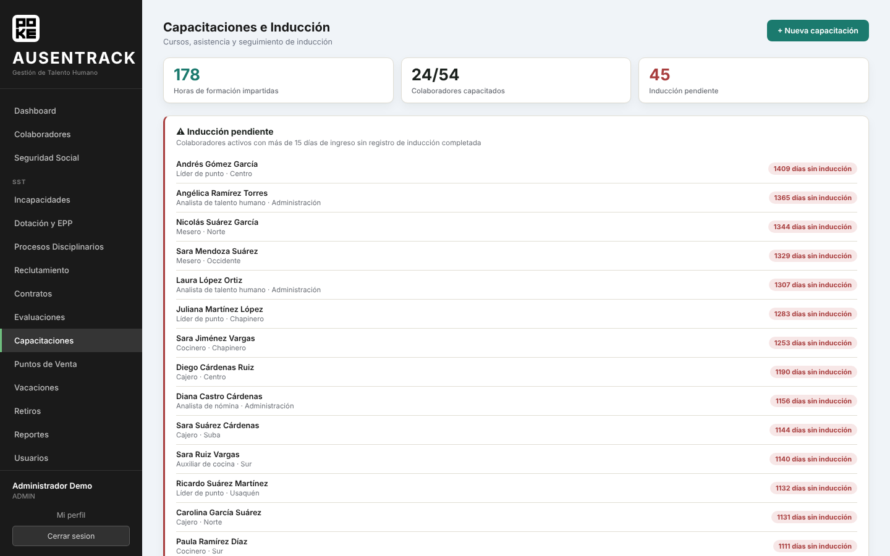 |
| **Puntos de venta** 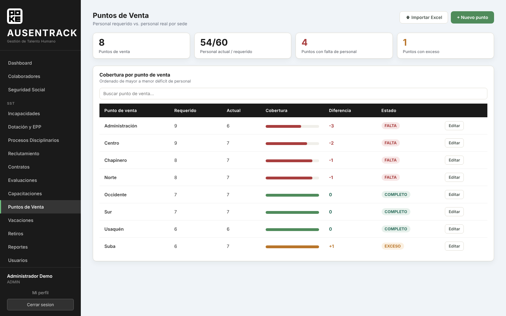 | **Procesos disciplinarios** 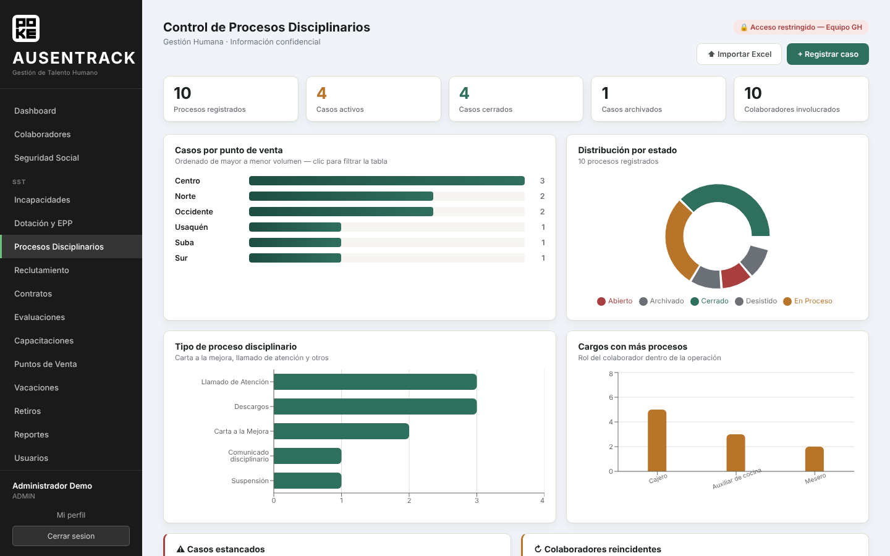 |
| **Retiros** 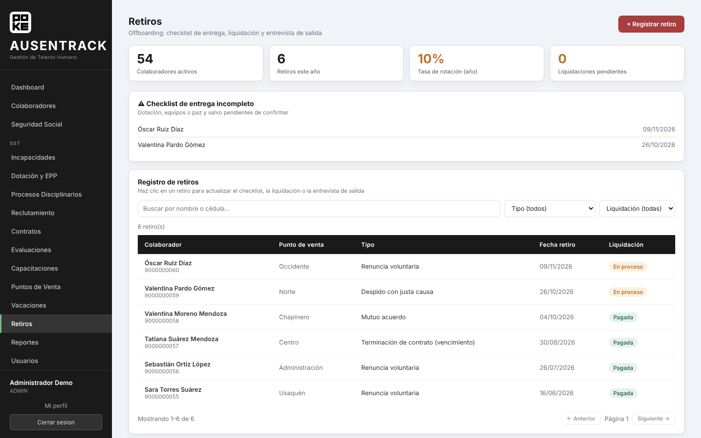 | **Dotación y EPP** 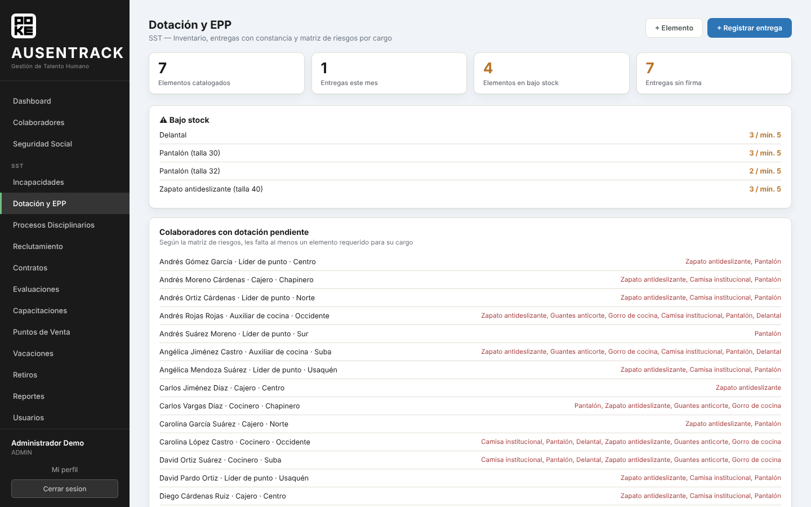 |
| **Reportes** 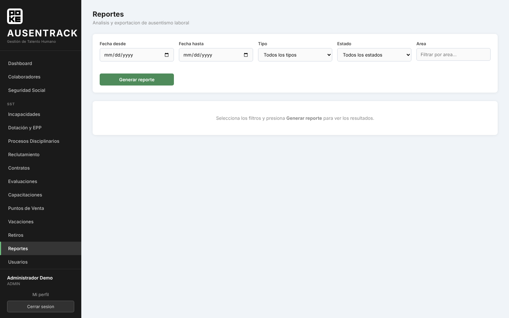 | **Auditoría** 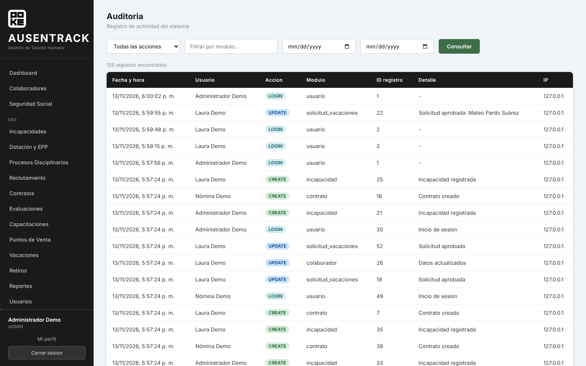 |

---

## Tecnologías

| Capa | Tecnología |
|------|------------|
| Backend | Python 3.11+ · Django 4.2 · Django REST Framework |
| Autenticación | SimpleJWT (con blacklist de tokens) |
| Base de datos | MySQL |
| Frontend | React 18 · React Router 6 |
| Gráficas | Recharts |
| Reportes | openpyxl (Excel) · ReportLab (PDF) |
| Configuración | python-decouple (variables de entorno) |

---

## Estructura del proyecto

```
AUSENTRACK/
├── sigi_backend/                # API REST Django
│   ├── authentication/          # Usuarios, roles, auditoría, JWT
│   ├── colaboradores/           # Personal, entidades, empresas, importación
│   ├── incapacidades/           # Incapacidades + prórrogas + documentos
│   ├── dotacion/                # Dotación y EPP (inventario, entregas, matriz)
│   ├── procesos_disciplinarios/ # Llamados de atención, cartas
│   ├── reclutamiento/           # Vacantes + candidatos (pipeline)
│   ├── contratos/               # Contratos, PDF, renovaciones
│   ├── evaluaciones/            # Desempeño + autoevaluación pública
│   ├── capacitaciones/          # Cursos + asistencia + inducción
│   ├── puntos_venta/            # Sedes + personal requerido
│   ├── vacaciones/              # Solicitudes + saldo + webhook JotForm
│   ├── retiros/                 # Offboarding + rotación
│   └── sigi_backend/            # settings.py, urls.py
│
└── sigi_frontend/               # SPA React
    └── src/
        ├── api/                 # Servicios HTTP (axios), uno por módulo
        ├── components/          # Layout, Modal, Tabla, ErrorBoundary
        ├── context/             # AuthContext (sesión)
        ├── utils/               # Helpers (formateo de errores)
        └── pages/               # Una carpeta por módulo
```

---

## Instalación local

### Requisitos
- Python 3.11 o 3.12 (evitar 3.13 por compatibilidad de dependencias)
- Node.js 18+ / npm 9+
- MySQL Server (o XAMPP con MySQL)
- Git

### 1. Backend

```bash
cd sigi_backend

python -m venv venv
venv\Scripts\activate          # Windows
# source venv/bin/activate     # Linux/Mac

pip install -r requirements.txt
```

> **Nota Windows:** el proyecto usa `pymysql` en vez de `mysqlclient`, porque
> este último requiere Visual C++ Build Tools para compilar. `pymysql` es puro
> Python y ya viene activado en `sigi_backend/sigi_backend/__init__.py`.

**Crea la base de datos:**
```sql
CREATE DATABASE sigi_db;
```

**Configura las variables de entorno.** La configuración sensible no está en
el código: copia la plantilla y ajústala.

```bash
copy .env.example .env          # Windows
# cp .env.example .env          # Linux/Mac
```

Edita `sigi_backend/.env` con tus datos reales de MySQL:

```
SECRET_KEY=<genera una con el comando de abajo>
DEBUG=True
ALLOWED_HOSTS=*

DB_NAME=sigi_db
DB_USER=root
DB_PASSWORD=tu_contraseña_de_mysql
DB_HOST=localhost
DB_PORT=3306
```

Para generar una `SECRET_KEY`:
```bash
python -c "from django.core.management.utils import get_random_secret_key; print(get_random_secret_key())"
```

**Migra y crea tu usuario administrador:**
```bash
python manage.py migrate
python manage.py createsuperuser
python manage.py runserver
```

Backend disponible en `http://127.0.0.1:8000`.

### 2. Frontend

```bash
cd sigi_frontend
copy .env.example .env          # Windows (opcional en local)
npm install
npm start
```

Frontend disponible en `http://localhost:3000`.

> El archivo `.env` del frontend solo define `REACT_APP_API_URL`. En local
> puedes omitirlo: por defecto apunta a `http://localhost:8000/api`.

### 3. Datos base necesarios

Antes de usar varios módulos hay que crear:

**Una empresa** (aún no tiene pantalla propia):
```bash
python manage.py shell -c "from colaboradores.models import Empresa; Empresa.objects.create(nit='TU_NIT', razon_social='Tu Empresa')"
```

**Los puntos de venta**, desde el módulo *Puntos de Venta* (manualmente o
importando la plantilla de Excel que el propio módulo genera).

---

## Datos de demostración

Para ver el sistema con contenido sin usar información real:

```bash
# 1. En sigi_backend/.env apunta a una base aparte:   DB_NAME=ausentrack_demo
# 2. En MySQL:   CREATE DATABASE ausentrack_demo CHARACTER SET utf8mb4;
cd sigi_backend
python manage.py migrate
python manage.py cargar_demo
```

Carga una empresa ficticia con 8 puntos de venta, 60 colaboradores y movimientos en todos los módulos, además de tres usuarios (uno por rol) cuya clave se muestra al terminar. Todo es inventado.

El comando **solo corre sobre una base vacía**: si ya hay colaboradores se detiene sin tocar nada, para no mezclar datos de prueba con información real. Al terminar la demostración, vuelve a poner en el `.env` el nombre de tu base de trabajo.

---

## Reglas configurables

| Variable (`.env`) | Por defecto | Qué controla |
|---|---|---|
| `VACACIONES_SABADO_HABIL` | `True` | Si el sábado cuenta como día hábil al descontar vacaciones (una semana completa descuenta 6 días). Ponlo en `False` si la jornada es de lunes a viernes. Los domingos y los festivos de Colombia nunca cuentan; los festivos se calculan solos para cualquier año. |

Los listados de la API aceptan `?page=` y `?page_size=` (máximo 200). Sin `page` devuelven la lista completa, como siempre.

---

## Pruebas automáticas

```bash
cd sigi_backend
python manage.py test
```

Cubren lo más delicado del sistema: quién puede ver qué según su rol, que los
documentos de incapacidades solo se entreguen con sesión iniciada, el conteo
de días y el límite de 540 en las prórrogas, el responsable de pago, la alerta
de 180 días acumulados, la administración de usuarios, los festivos y días
hábiles, las reglas de aprobación de vacaciones, los filtros de auditoría y
el comando de datos de demostración. Django crea y borra
una base de datos temporal (`test_sigi_db`); la base real no se toca.

---

## Despliegue a producción

La configuración de seguridad (HTTPS forzado, HSTS, cookies seguras) **se
activa automáticamente al poner `DEBUG=False`** en el `.env`.

Los pasos completos, el `.env` de producción y la lista de verificación están
en **[GUIA_DESPLIEGUE.md](GUIA_DESPLIEGUE.md)**.

> **Importante:** nunca subas a Git el archivo `.env`, respaldos de base de
> datos, ni archivos con datos reales de colaboradores (nombres, cédulas,
> diagnósticos). El `.gitignore` ya los excluye — consérvalo así, por la Ley
> 1581 de 2012 de protección de datos personales.

---

## Roles del sistema

| Rol | Acceso |
|---|---|
| **ADMIN** | Todo, incluyendo eliminar registros y gestionar usuarios |
| **TALENTO_HUMANO** | Todos los módulos de gestión de personal (crear/editar) |
| **NOMINA** | Consulta de colaboradores y datos relacionados con el pago |

---

## Normativa aplicada

| Norma | Aplicación en el sistema |
|-------|--------------------------|
| Ley 100/1993 Art. 227 | Responsable de pago de incapacidades (empleador días 1-2, EPS desde el día 3) |
| Ley 100/1993 | Límite de 540 días para incapacidades prorrogables |
| Decreto 1406/1999 | Reconocimiento y pago de incapacidades por enfermedad general |
| Decreto 1333/2018 | Incapacidades de origen laboral (ARL) |
| Ley 1822/2017 | Licencia de maternidad |
| Código Sustantivo del Trabajo | Vacaciones: 15 días hábiles por año trabajado (1.25 días/mes) |
| Ley 1581/2012 | Tratamiento de datos personales (Habeas Data) |

---

## Documentación

| Documento | Contenido |
|---|---|
| `Manual_Usuario_AUSENTRACK.docx` | Guía paso a paso de cada módulo |
| `Manual_Tecnico_AUSENTRACK.docx` | Arquitectura, endpoints, mantenimiento |
| `GUIA_DESPLIEGUE.md` | Puesta en producción |
| `Marco_Teorico_SIGI.docx` y demás | Documentación académica del proyecto de grado |

---

## Licencia

MIT License — libre para uso académico y educativo.
